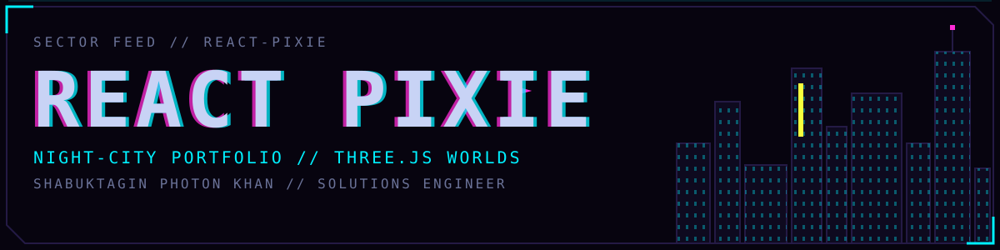

<!-- React Pixie. The HUD palette: void #07040F, panel #0E0A1F, cyan #00F0FF, magenta #FF2BD6, one volt #F5FF3D. -->

<div align="center">




**SHABUKTAGIN PHOTON KHAN** `// solutions engineer, ex senior full stack`

<a href="https://react-pixie.vercel.app/"></a>
<a href="https://github.com/mp5maker"></a>
<a href="https://www.linkedin.com/in/shabuktaginkhan/"></a>
<a href="https://photons-blog.netlify.app/"></a>


</div>

## `$ whoami`

```console
photon@react-pixie:~$ whoami
  photon. shabuktagin khan.
$ role
  solutions engineer. ex senior full stack.
$ do
  client problem in. poc out. docker, podman, rhel, aws, shell. live troubleshoot.
$ roots
  react, next, react native. node, nest, express. python, django, flask.
  typescript, graphql, postgres.
$ now
  kubernetes. terraform. ansible.
$ also
  hire, train, demo. explored go, rust, ethical hacking.
$ off
  guitar. drones. video edit.
```

## `$ map --sectors`

You fly through this portfolio instead of scrolling it. Every page is a 3D world in one cyberpunk city, and the HUD on top of it is the interface.

| Sector | Route | Reach it by | What is there |
|---|---|---|---|
| Open space | `/` | About me | The ID card. A fleet of spaceships and the JWST fly around a spinning box. Graze a ship and it morphs into another class. Click the box and the fleet dives into it, then breaks into the skill shards of `/experience`. |
| Shard field | `/experience` | Experience | The skill loadout, with each skill floating as a shard. Click the box to go back: the shards fly home and rebuild every craft. |
| Storm district | `/rain` | Flow | A ruined city under a lightning storm. Ships still run the sky lanes between the towers. |
| Drowned city | `/bird` | Elevation | The same skyline after the flood. Flocks cross the water, pods climb a space elevator, and everyone heads for the ark above the clouds. |
| Collapse | `/physics` | `←` or swipe left | Torn floors, girders, signs and crashed craft fall from the drowning towers. They hit the broken decks, slide off and sink into the flood. The physics is real: cannon.js running in a web worker. |
| Broken planets | `/skybox` | `→` or swipe right | Shattered planets, each a cyberpunk city of its own. The pieces and the wrecked craft drift together, trying to merge. |
| Dead zone | any other URL | a bad link | The 404 page is a zombie survival game. |

## `$ trace --entry`

The camera never just appears in a world. Each world checks where you came from and flies in its own way. The HUD names the shot while it plays.

| From | Into | Shot |
|---|---|---|
| open space | a city or `/physics` | `ATMOSPHERIC ENTRY`: straight down out of orbit |
| a city | open space | `ESCAPE VELOCITY`: up through the starfield |
| `/rain` | `/bird` | `WATER RISING` |
| `/bird` | `/rain` | `WATER DRAINING` |
| `/physics` | a city | `HIGH DROP`: free fall, then a hard pull-up |
| a city | `/physics` | `FREEFALL`: down with the debris |
| open space | `/skybox` | `WARP EXIT` |
| a city | `/skybox` | `LEAVING ATMOSPHERE` |
| `/skybox` | open space | `JUMP EXIT` |
| `/` | `/experience` (menu) | `DIVE TO CORE` |
| `/experience` | `/` (menu) | `PULLING OUT` |
| `/` | `/experience` (box) | the fleet crash, and the rebuild on the way back |

## `$ man controls`

| Input | Does |
|---|---|
| `↑` `↓`, mouse wheel, vertical swipe | Move through the menu sectors |
| `→` or swipe right | Go to `/skybox` (press again to go back) |
| `←` or swipe left | Go to `/physics` (press again to go back) |
| `Enter` / `Esc` | Open / close the settings drawer |
| `L` / `D` | Light / dark theme |
| `E` / `B` | English / বাংলা |
| `H` | Show the keyboard shortcuts |
| Pointer | Camera parallax in the cities |

The settings drawer changes with the sector: box rotation and starfield warp speed in open space, storm speed or a bonfire in place of the storm in `/rain`, bloom in `/bird`. The music player has its own volume control. With `prefers-reduced-motion` on, every world holds still. Phones get lighter scenes.

## `$ boot`

You need Node 22. The version is in `.nvmrc`.

```bash
nvm use
npm run install:legacy   # npm install --legacy-peer-deps, for the React 16 dependency tree
npm run dev              # http://localhost:3000
```

| Command | Does |
|---|---|
| `npm run dev` | Dev server with hot reload |
| `npm test` | Jest and Testing Library |
| `npm run lint` | ESLint over `src` |
| `npm run build` | Production build into `build/` |
| `npm start` | Express serves `build/` on `PORT` (default `8080`), plus the Storybook build at `/storybook` |
| `npm run storybook` | Storybook on port `9009` |
| `npm run build-storybook` | Storybook build into `.storybook/build` |

`dev`, `build` and `test` set `NODE_OPTIONS=--openssl-legacy-provider`, because webpack 4 needs it on Node 17 and later.

## `$ cat /proc/stack`

- React 16 and TypeScript on Create React App 3
- three.js through react-three-fiber. use-cannon runs the physics in a web worker
- framer-motion for the HUD, react-router for the sectors
- i18next (English, Bengali), react-hotkeys, howler for the music
- Storybook for the buttons. Jest and Testing Library for the tests

## `$ tree src`

```text
src/
├── Components/Anime/ThreeJS/
│   ├── Pages/        one canvas per sector
│   ├── Entrance/     entry shots, keyed by the route you came from
│   ├── Fleet/        the ships, the JWST, the crash and the rebuild
│   ├── Ruins/        the seeded skyline and the scene helpers the worlds share
│   ├── Storm/        lightning over /rain
│   ├── Traffic/      sky lanes and ships on missions
│   ├── Exodus/       the ark and the space elevator over /bird
│   ├── Debris/       the falling wreckage of /physics
│   ├── Planets/      the broken planets of /skybox
│   └── ZombieGame/   the 404
├── Components/       HUD panels: navigation, loadout, settings, music
├── Hooks/            media queries, swipe, scene colours, scroll lock
├── Locales/          en, bn
└── Utilities/RouteFrom/  remembers the last route for the entry shots
```

<div align="center">

`// EOF`

</div>
